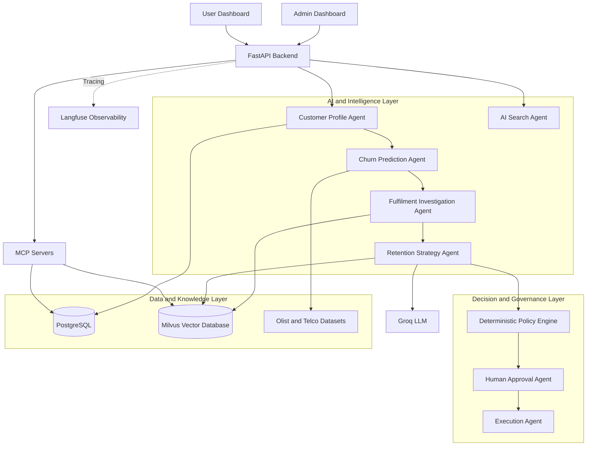
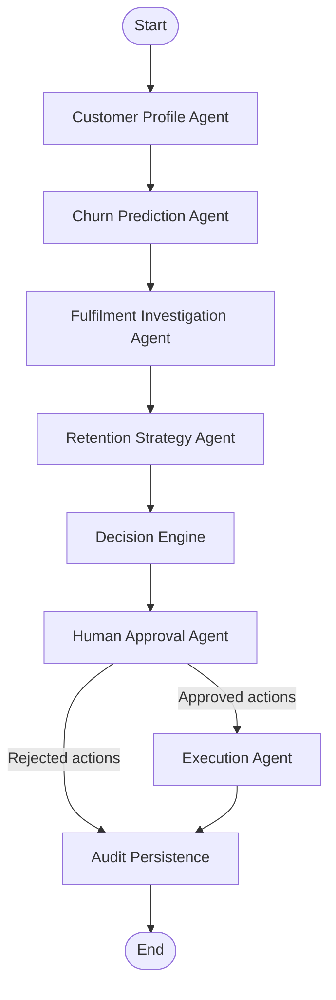
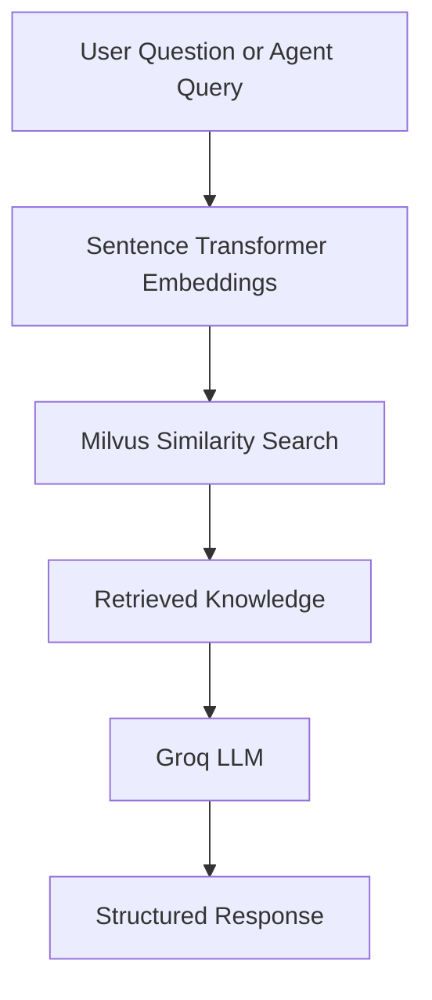

# Customer Churn & Retention Through Fulfilment Intelligence

An AI-powered customer intelligence system that combines churn-risk analysis, fulfilment investigation, explainable machine learning, and policy-compliant retention recommendations.

<p align="center">
  <strong>Customer Analytics · Explainable AI · Agentic AI · Retention Intelligence</strong>
</p>

---

## 1. Project Overview

Customer Churn & Retention Through Fulfilment Intelligence is an intelligent decision-support system designed to investigate customer behaviour, identify potential retention risks, analyse fulfilment-related issues, and recommend appropriate retention actions.

The system combines machine learning, data analytics, multi-agent orchestration, retrieval-augmented generation (RAG), and human-in-the-loop approval.

Instead of relying only on churn predictions, the system considers customer activity and operational evidence before recommending retention strategies.

### Key Capabilities

- Customer profiling and behavioural analysis.
- Churn-risk prediction using a supervised ML benchmark.
- Explainable predictions using SHAP.
- Fulfilment investigation using customer orders, delivery delays, cancellations, and review information where available.
- AI-generated retention recommendations.
- Knowledge retrieval using Milvus and embeddings.
- Multi-agent orchestration using LangGraph.
- Tool discovery and execution through MCP servers.
- Deterministic policy validation.
- Human approval before retention actions proceed.
- Workflow observability through Langfuse.
- REST APIs and separate Admin and User dashboards.

---

## 2. Project Objectives

1. Analyse customer purchasing behaviour and fulfilment performance.
2. Identify potential customer retention risks using defensible targets.
3. Explain model predictions through feature-level explanations.
4. Investigate operational factors associated with customer dissatisfaction.
5. Generate context-aware retention recommendations.
6. Enforce eligibility, budget, and contact-frequency constraints.
7. Require human approval before action execution.
8. Maintain traceability of customer investigations and decisions.

---

## 3. Selected Datasets

The project uses three separate datasets for different analytical purposes.

| Dataset | Purpose |
|---|---|
| Olist Brazilian E-Commerce | Primary customer behaviour and fulfilment analysis |
| IBM Telco Customer Churn | Separate supervised churn prediction benchmark |
| Synthetic Campaign and Incentive Data | Hypothetical retention-action and decision scenarios |

### Olist Brazilian E-Commerce

Olist is the primary dataset for customer and fulfilment investigation.

Analysis includes:

- Customer purchase history.
- Order frequency and recency.
- Order cancellations.
- Delivery performance.
- Estimated versus actual delivery dates.
- Customer review patterns.
- Inactivity-based retention-risk indicators.

**Important limitation:** Olist does not provide a verified customer churn label. An inactivity-based proxy is not equivalent to confirmed churn.

A future-outcome target must be defined and validated against temporal coverage before training a supervised Olist churn model.

### IBM Telco Customer Churn

IBM Telco is used as a separate supervised churn benchmark.

It supports:

- Binary churn classification.
- Customer tenure and service analysis.
- Contract and payment behaviour analysis.
- Model evaluation.
- Threshold selection.
- Explainability using SHAP.

The Olist and Telco datasets remain separate because they represent different customer populations and schemas.

### Synthetic Campaign and Incentive Data

Synthetic data is used to model hypothetical retention scenarios, including:

- Retention action types.
- Incentive eligibility.
- Campaign costs.
- Budget constraints.
- Contact-frequency limits.
- Hypothetical action outcomes.

Synthetic scenarios are useful for testing decision logic but cannot establish real-world campaign effectiveness.

---

## 4. System Architecture

The system is organised into separate data, ML, orchestration, decision, and application layers.

### High-Level Application Architecture



### Agentic AI Workflow



The workflow also supports a separate AI Search route for knowledge retrieval and MCP tool interaction.

---

## 5. Multi-Agent System

The application uses LangGraph to coordinate specialised agents through a shared workflow state.

| Agent | Responsibility |
|---|---|
| Customer Profile Agent | Retrieves and prepares customer information |
| Churn Prediction Agent | Generates churn-risk estimates where a valid model and target are available |
| Fulfilment Agent | Investigates operational and delivery-related evidence |
| Retention Strategy Agent | Generates context-aware retention recommendations |
| Decision Engine Agent | Evaluates candidate actions using deterministic policies |
| Human Approval Agent | Requests admin approval or rejection |
| Execution Agent | Processes approved actions |
| AI Search Agent | Answers questions using retrieved knowledge and MCP tools |

### Workflow Governance

The system separates recommendation from approval and execution.

1. AI agents investigate and generate candidate actions.
2. The policy engine evaluates eligibility and constraints.
3. Feasible actions are submitted for human review.
4. The admin approves or rejects the proposed actions.
5. Approved actions are passed to the execution stage.
6. Investigation and decision information is maintained for auditing.

---

## 6. Model Development and Explainability

The ML component uses Scikit-learn for supervised churn classification.

### Model Development

- Data cleaning and preprocessing.
- Feature engineering.
- Train, validation, and test separation.
- Baseline classifier development.
- Alternative model comparison.
- Class imbalance analysis.
- Decision-threshold selection.
- Precision, recall, F1-score, and PR-AUC evaluation where appropriate.

### Explainable AI with SHAP

SHAP is used to understand the contribution of input features to model predictions.

It helps explain:

- Which features influenced a prediction.
- Whether a feature increased or decreased predicted risk.
- How individual customer predictions differ.
- Which features are important across the model.

Model predictions are decision-support signals, not proof of customer intent.

---

## 7. Decision and Retention Layer

The decision layer evaluates proposed retention actions before they reach the human approval stage.

### Candidate Retention Actions

- Personalised re-engagement.
- Customer support follow-up.
- Loyalty reward.
- Product recommendation.

### Deterministic Policy Controls

The policy engine applies rules relating to:

- Allowed action types.
- Customer eligibility.
- Availability of supporting evidence.
- Budget constraints.
- Contact-frequency limits.
- Human approval requirements.

Actions that do not satisfy policy requirements should be rejected or routed for further review.

**Decision-layer status:** The current implementation uses a custom deterministic policy engine. OpenJEV is a planned integration and should not be considered part of the implemented architecture until integration and testing are complete.

---

## 8. MCP and Knowledge Retrieval

The system uses Model Context Protocol (MCP) to expose application tools to AI agents.

### MCP Servers

**PostgreSQL MCP Server**

Provides tools for:

- Retrieving customer profiles.
- Counting customer records.
- Finding inactive Olist customers.

**Retention MCP Server**

Provides tools for:

- Searching retention knowledge.
- Retrieving knowledge-base status.

### RAG Architecture



The knowledge retrieval system uses sentence-transformer embeddings and Milvus vector search.

---

## 9. Technology Stack

| Category | Technologies |
|---|---|
| Programming Language | Python |
| Data Analysis | Pandas, NumPy |
| Machine Learning | Scikit-learn |
| Explainable AI | SHAP |
| Backend | FastAPI |
| Data Validation | Pydantic |
| Database | PostgreSQL |
| Vector Database | Milvus |
| Agent Orchestration | LangGraph |
| LLM | Groq |
| Tool Integration | MCP |
| Embeddings | Sentence Transformers |
| Observability | Langfuse |
| Frontend | Streamlit |
| Testing | Pytest |
| Environment Management | Python Virtual Environment |

---

## 10. Project Structure

```text
customer-churn-retention-mvp/
│
├── data/
│   ├── raw/
│   ├── processed/
│   └── synthetic/
│
├── docs/
│   ├── problem_statement.md
│   ├── user_stories.md
│   ├── dataset_documentation.md
│   └── architecture.md
│
├── notebooks/
│   ├── 01_data_understanding.ipynb
│   └── 02_eda.ipynb
│
├── scripts/
│
├── src/
│   └── retention_intelligence/
│       ├── agents/
│       ├── api/
│       ├── db/
│       ├── decision/
│       ├── graph/
│       ├── milvus/
│       ├── rag/
│       ├── schemas/
│       └── services/
│
├── m